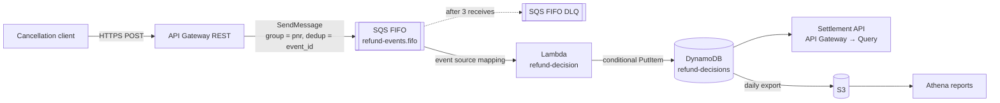
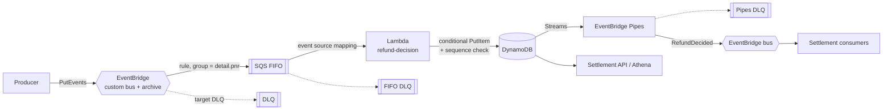
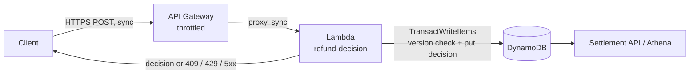

# M2 – Cancellation refund decisions: three architecture options

| | |
|---|---|
| Status | Draft for HITL review (`docs/HITL_REVIEW_TEMPLATE.md`) |
| Region | `us-east-1` |
| Flow | A cancellation event (`pnr`, `ticket_number`, `fare_class`, `departure_status`, `no_show_flag`, `fare_amount`) gets a refund decision (`APPROVE` / `REJECT` / `MANUAL_REVIEW`). The settlement team sees every decision. |
| Volume | 2,000 events/day normally; up to 50/min during flight disruptions |
| Ordering | Sequential per `pnr`; parallel across PNRs |
| Non-goals | No Kinesis, MSK, EC2, Kubernetes or containers. Never log passenger names, emails or `fare_amount`. |
| Naming | Every resource `accelya-m2-<learner>-…` |

Example event and expected decision:

```json
{"event_id": "evt-1002", "pnr": "LM4K8D", "fare_class": "K", "departure_status": "scheduled",
 "no_show_flag": false, "fare_amount": "4120.00"}
```

```json
{"decision": "APPROVE", "refund_rule_id": "R-SAVER", "refund_amount": "3090.00"}
```

---

## 0. Common to all options

- **Decision logic:** the Day 2 `cancellation` handler (`day2/src/cancellation/handler.py`). It is pure functions, uses Decimal with ROUND_HALF_UP, and logs no PII.
- **Decision store:** DynamoDB table `accelya-m2-<learner>-refund-decisions`.
  - Key: `pk = PNR#<pnr>`, `sk = EVT#<event_id>`.
  - A secondary index on `settlement_date` + `decision` serves settlement queries.
  - Each write is conditional on `attribute_not_exists(sk)`. This is the long-lived duplicate check, because SQS FIFO only removes duplicates within a 5-minute window.
- **Logs:** one JSON object per line following `docs/LOGGING_CONTRACT.md`, with `correlation_id = event_id`. Never `fare_amount`, passenger names, emails or message bodies.
- **Settlement visibility:**
  - a read-only API: API Gateway with IAM or Cognito auth, querying DynamoDB through a direct integration;
  - reports: a daily DynamoDB export to S3, queried with Athena.

---

## Option A – API Gateway → SQS FIFO → Lambda → DynamoDB *(recommended)*

**Summary:** A FIFO queue grouped by PNR (`MessageGroupId = pnr`) puts each PNR's events in a strict order and absorbs traffic spikes, while different PNRs are processed in parallel.

**Services in order:** Cancellation client → API Gateway (REST) → SQS FIFO `refund-events.fifo`, with a FIFO DLQ → Lambda `refund-decision` → DynamoDB `refund-decisions` → settlement API and Athena reports



### Six service-boundary answers

| Hop | Trigger | Data passed | Sync / async | If the next service fails | Retries and duplicates | Ordering |
|---|---|---|---|---|---|---|
| Client → API Gateway | HTTPS POST | Cancellation event JSON | Sync | Client gets a 5xx or 429 and retries with the same `event_id` | Client retries; duplicates are handled downstream | Per PNR, the client must send in order (assumption) |
| API Gateway → SQS FIFO | Direct `SendMessage` service integration, no Lambda | Body, `MessageGroupId = pnr`, `MessageDeduplicationId = event_id` | Sync: the client gets 200 only after SQS accepts the message | SQS error → 5xx to the client, nothing is stored, the client retries | FIFO drops a repeated `event_id` within 5 minutes | Ordered per message group from the point SQS accepts the message |
| SQS FIFO → Lambda | Lambda event source mapping polls the queue | Batch of up to 10 messages | Async to the producer, sync poll for Lambda | A message returns to the queue after its visibility timeout. After `maxReceiveCount = 3` it moves to the FIFO DLQ, and only then do that PNR's later messages run | Partial batch response: report the failed message *and all after it* in the batch, so order holds | Lambda processes one batch at a time per message group. Different PNRs scale out in parallel |
| Lambda → DynamoDB | `PutItem` with a condition | Decision, rule id, Decimal refund amount, `event_id`, `settlement_date` (no passenger data) | Sync | Throttling → SDK retry, then the message is retried from the queue | A failed condition means already decided: log it at INFO and treat it as success | The queue already enforces the order |
| DynamoDB → settlement | API Gateway GET → DynamoDB `Query`; daily export to S3 → Athena | Decisions only | Sync (API) / batch (reports) | API 5xx; the export can be re-run | Reads only | Sort key ordering per PNR |

### Two major risks

1. **One bad event blocks its PNR.** A message that keeps failing blocks that PNR's group until it reaches the DLQ, which takes about 3 × the visibility timeout. Once it is in the DLQ, later events for that PNR run **without** it, so the DLQ needs an owner and a replay process.
2. **Ordering starts at the queue.** If the client sends two events for the same PNR at the same time, the queue orders them by arrival, not by when they happened. Mitigation: carry a timestamp or sequence number on each event and reject stale ones with a conditional check.

### Rough cost drivers

At about 60k events a month, API Gateway REST costs about $0.21, SQS FIFO about $0.03, and Lambda and DynamoDB on-demand only cents each. CloudWatch Logs, alarms and a customer-managed KMS key (if used) cost more than the processing itself. QuickSight, if added, would dominate at roughly $24 per author per month. The full breakdown is in §5.

---

## Option B – EventBridge bus → SQS FIFO → Lambda → DynamoDB → Streams → EventBridge

**Summary:** Cancellations are published as events on a custom EventBridge bus. A FIFO queue keeps per-PNR order for the decision step, and decisions are published back as events so settlement and other teams can subscribe.

**Services in order:** Producer `PutEvents` → EventBridge custom bus, with archive and replay → rule → SQS FIFO (group = `$.detail.pnr`) → Lambda → DynamoDB → Streams → EventBridge Pipes → bus `RefundDecided` event → settlement consumers, plus the API and Athena as in Option A



### Six service-boundary answers

| Hop | Trigger | Data passed | Sync / async | If the next service fails | Retries and duplicates | Ordering |
|---|---|---|---|---|---|---|
| Producer → EventBridge | `PutEvents` API | Event envelope with `detail` = the cancellation | Sync accept | Check `FailedEntryCount` and retry the failed entries | At-least-once delivery | **None.** The bus does not guarantee order |
| EventBridge → SQS FIFO | Rule target | `detail`, `MessageGroupId = pnr`, dedup id = `event_id` | Async | Retries for up to 24 hours (configurable), then the target DLQ | Duplicates are possible; FIFO dedup catches them within 5 minutes | Ordered only from when SQS accepts the message. Two events for the same PNR can reach the queue out of order |
| SQS FIFO → Lambda | Event source mapping | Batch | Async | Same as Option A | Same as Option A | Per group, as in Option A |
| Lambda → DynamoDB | Conditional `PutItem`, plus a sequence check on the PNR item | Decision | Sync | Same as Option A | Conditional write on `event_id`, **and** reject events older than the PNR's last processed sequence number | The sequence check **is** the ordering control, because the bus can reorder |
| DynamoDB Streams → Pipes → EventBridge | Stream poller | New decision record only (no passenger data) | Async | Pipes retries, then its DLQ | At-least-once, so consumers must remove duplicates by `event_id` | Stream records for one item stay in order. Across items, ordering doesn't matter here |

### Two major risks

1. **Order can break on the bus.** EventBridge can deliver events out of order during a spike. Correctness then depends on producers sending a reliable sequence number, and that is a contract you have to enforce.
2. **More moving parts.** There are more DLQs (EventBridge target, SQS, Pipes) to monitor and replay, and more IAM and resource policies to review.

### Rough cost drivers

Custom events at about $1 per million (around $0.06 a month here). Pipes and Streams cost cents. The event archive adds storage and replay charges. In practice CloudWatch and the extra DLQ alarms cost more than the event traffic.

---

## Option C – Synchronous API Gateway → Lambda → DynamoDB, with per-PNR locking

**Summary:** No queue. Each cancellation gets its decision in the API response, and concurrent requests for the same PNR are serialised by a conditional "version" check on a PNR item in DynamoDB.

**Services in order:** Client → API Gateway (REST, with throttling) → Lambda `refund-decision` → DynamoDB transaction (bump the PNR item's version + insert the decision) → response to the client → settlement API and Athena as in Option A



### Six service-boundary answers

| Hop | Trigger | Data passed | Sync / async | If the next service fails | Retries and duplicates | Ordering |
|---|---|---|---|---|---|---|
| Client → API Gateway | HTTPS POST | Event JSON | Sync | 429 when throttled, 5xx on error; **the client must retry**, nothing is buffered | Client retries | Client's responsibility |
| API Gateway → Lambda | Proxy integration | Event | Sync (29 s integration timeout) | Error goes back to the client | Retries only if the client retries | None |
| Lambda → DynamoDB | `TransactWriteItems`: update the PNR item where `version = :expected` + put the decision where `attribute_not_exists` | Decision + new PNR version | Sync | A conflict returns 409 and the client retries; throttling is retried by the SDK | A duplicate `event_id` fails the condition and the stored decision is returned (idempotent response) | **Optimistic locking**: two concurrent events for one PNR cannot both commit, so the loser retries. This serialises them but does not order them by event time |
| DynamoDB → settlement | Same as Option A | | | | | |

### Two major risks

1. **Spikes become client errors.** During a disruption, throttling, Lambda concurrency limits or DynamoDB conflicts reach the caller as errors. Nothing buffers the events, so a client that doesn't retry **loses events**. This fails the "no lost events" requirement unless every producer is reliable.
2. **Locking serialises but does not order.** With retries, the event that wins can be the later one, so refund decisions may still conflict.

### Rough cost drivers

API Gateway and Lambda at roughly the same tiny totals as Option A. DynamoDB transactions cost 2× normal writes and conflict retries add more, but it's still cents. It's cheapest on paper, and the cost is paid in reliability.

---

## 4. Comparison

| | A: API GW → SQS FIFO → Lambda | B: EventBridge → FIFO → Lambda → Streams | C: Sync API + locking |
|---|---|---|---|
| Complexity | Low (4 managed services, 1 Lambda) | Medium–high (bus, rules, Pipes, Streams, 3 DLQs) | Lowest to build, but the client has to handle retries |
| Per-PNR ordering | **Strict FIFO per PNR** from the queue on | Only via the producer's sequence number; the bus can reorder | Serialised, not ordered |
| Reliability | High: the queue stores events durably, with retries and a DLQ | High, with archive and replay, but more failure points | Depends on the client; events can be lost under throttling |
| Scalability | Absorbs spikes; a single queue handles thousands of messages per second; parallel across PNRs | Same, plus fan-out to other consumers | Limited by API throttle and Lambda concurrency at peak |
| Operational overhead | 1 DLQ and its replay | Several DLQs and policies | Low on AWS, high for the client teams |
| Cost (about 60k events/month) | Cents plus CloudWatch | Cents plus more CloudWatch | Cents |
| Settlement visibility | API + Athena | API + Athena + **decision events** for others to subscribe to | API + Athena |

### Recommendation: Option A

- **Ordering:** it is the only option where per-PNR ordering is a **built-in feature of the service** (SQS FIFO message groups), not something resting on producers or client retries.
- **No lost events:** the queue stores every accepted event durably. 50 events a minute at peak is trivial for it, there's no capacity to manage, and Lambda scales out across PNRs automatically.
- **Duplicates:** these are handled twice. FIFO removes duplicates within 5 minutes, and the conditional write on `event_id` catches repeats at any time.
- **Simplicity and cost:** one Lambda, one DLQ, and almost no cost at this volume.
- **Growth path:** if other teams later need to react to refund decisions, add Option B's DynamoDB Streams → EventBridge stage on top. Ingestion and ordering stay the same.

**Open decisions before building:**
1. Should every event carry a per-PNR sequence number, so that events arriving at the same moment can't be decided out of order?
2. Who owns replaying events from the DLQ?

---

## 5. Cost evaluation – Option A

Option A costs **about $1–2 a month for the core pipeline, about $4–6 with production monitoring, and about $13–16 if you put AWS WAF in front of the API**. Per-event charges are tiny. The bill is driven almost entirely by fixed monthly charges: alarms, custom metrics, the encryption key and WAF.

**Assumptions:**
- **Volume:** 2,000 events a day is about 60,000 a month. I add about 18,000 for disruption peaks (50 a minute for 6 hours), so the base is **about 78,000 events a month**.
- **Event size:** under 1 KB.
- **Lambda:** 256 MB, about 200 ms per run.
- **DynamoDB:** one decision write plus one secondary-index write per event.
- **Settlement reads:** about 10,000 queries a month.
- **Logs:** about 5 lines of 300 bytes per event.
- **Prices:** us-east-1 list prices, **excluding the free tier** (which would cover most of the per-event charges). Check them in the AWS Pricing Calculator before committing to a budget.

### Monthly cost by service

| Service | What you pay for | Estimate at ~78k events | Notes |
|---|---|---|---|
| API Gateway (REST) | $3.50 per million requests | ≈ $0.28 | An HTTP API at $1.00/million would be ≈ $0.08. It can also send to SQS FIFO directly, but it can't sit behind WAF. |
| SQS FIFO (main queue + DLQ) | $0.50 per million requests: send, receive, delete, plus Lambda's idle polling | ≈ $0.30–0.50 | **Idle polling is most of this.** Lambda checks the queue all the time, even with no traffic, which is roughly 0.5–1 million requests a month. Use SQS-managed encryption: it's free. |
| Lambda | $0.20 per million runs + $0.0000167 per GB-second | ≈ $0.08 | About 3,900 GB-seconds. Not meaningful. |
| DynamoDB on-demand | $0.625 per million writes, $0.125 per million reads | ≈ $0.10 writes + ≈ $0.01 reads | The secondary index doubles write units. |
| DynamoDB storage + PITR | $0.25 per GB-month + $0.20 per GB-month | ≈ $0.02 in month 1, ≈ $0.20 after a year | Grows by about 40 MB a month. |
| Daily export to S3 + Athena | $0.10 per GB exported; Athena $5 per TB scanned (10 MB minimum per query) | ≈ $0.10–0.30 | Both are tiny at this table size. |
| CloudWatch Logs | $0.50 per GB ingested, $0.03 per GB stored | ≈ $0.10–0.20 | Includes API Gateway access logs. Keep retention at 30 days. |
| **Subtotal: core pipeline** | | **≈ $1–2 / month** | |
| CloudWatch alarms | $0.10 per alarm | ≈ $0.60–1.00 | 6–10 alarms: DLQ depth, oldest message age, Lambda errors and duration, API 5xx, DynamoDB throttles. |
| Custom metrics (EMF) | $0.30 per metric | ≈ $1.50–3.00 | For example decisions by type (APPROVE, REJECT, MANUAL_REVIEW), DLQ replays, refund rule hits. **Dimension combinations multiply the count**, so avoid dimensions like `fare_class`. |
| KMS customer-managed key (optional) | $1 per key per month + $0.03 per 10k calls | ≈ $1–2 | Only if security requires your own key. AWS-owned or managed keys are free. |
| X-Ray (optional) | $5 per million traces, first 100k free | ≈ $0 | |
| **Subtotal: with monitoring** | | **≈ $4–6 / month** | |
| AWS WAF on the API (optional) | $5 per web ACL + $1 per rule + $0.60 per million requests | ≈ $8–10 | **This would be the largest single cost.** Use it only if the API is exposed beyond trusted callers. |
| QuickSight (optional) | about $24 per author per month | $24+ | Only if the settlement team needs a dashboard. Athena + Excel, or the query API, are much cheaper. |

### How cost grows with volume

| Scenario | Events/month | Core | With monitoring |
|---|---|---|---|
| Today | ~78k | ≈ $1–2 | ≈ $4–6 |
| 10× | ~780k | ≈ $3–4 | ≈ $6–9 |
| 100× | ~7.8M | ≈ $25–35 | ≈ $30–40 |

That works out to **about $0.000015–0.00003 per refund decision** at today's volume. Cost grows close to linearly with volume, because the main per-event charges (API Gateway, SQS, DynamoDB writes) all scale directly. There is no capacity to buy in advance, and peak days cost nothing extra beyond their own events.

### How to keep it cheap

1. **Choose the API type deliberately.** An HTTP API is about 70% cheaper than REST. Choose REST only if you need WAF, usage plans or API keys.
2. **Keep custom metrics few and low in combinations.** They are the easiest line to let grow by accident.
3. **Set log retention and keep logs to identifiers and counts.** The logging contract already requires this, and it also keeps ingestion small.
4. **Use free encryption keys** (SQS-managed, and AWS-owned for DynamoDB) unless compliance requires your own key.
5. **Don't tune Lambda batching to save money.** For a FIFO queue, a larger batch size or batch window only adds delay for each PNR, and the saving is cents.

**Bottom line:** at this volume the cost of Option A is not a reason to choose against it. Alerting, security options (WAF, your own KMS key) and a possible dashboard decide the bill, not the event traffic.
