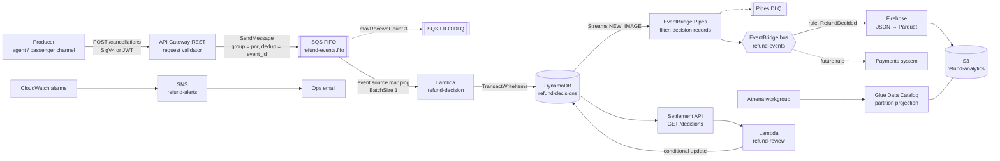

# M2 – Cancellation refund decisions: final architecture

| | |
|---|---|
| Status | **Decided – for peer review** (score with `docs/HITL_REVIEW_TEMPLATE.md`) |
| Author | Hassan (learner id `hassan`) |
| Date | 2026-11-25 |
| Region | `us-east-1` only |
| Builds on | `m2-cancellation-refund-architecture-options.md` (Options A/B/C). Option A is the base. Fixes from the critical review and the AGENTS.md review are applied. A near-real-time analytics path (EventBridge → Firehose → S3 → Glue/Athena) and SNS alerting are added. |
| IaC | One AWS SAM template: `day2/refund-pipeline-template.yaml`. No console changes. |
| Naming | Every resource is `accelya-m2-hassan-…` |

---

## 1. What this system does (and does not do)

**In scope**
- Accept cancellation events (`event_id`, `pnr`, `ticket_number`, `fare_class`, `departure_status`, `no_show_flag`, `fare_amount`, `currency`, `event_time`).
- Decide `APPROVE` / `REJECT` / `MANUAL_REVIEW` using `day2/data/refund_rules.json`, with money in `Decimal` and `ROUND_HALF_UP`.
- Store every decision durably, exactly once per `event_id`, and **at most one final refund decision per `ticket_number`**.
- Show every decision, every rejected (invalid) event and every failed event to the settlement team:
  - the API: live;
  - Athena: within about 5 minutes.
- Let a reviewer finish a `MANUAL_REVIEW` decision.

**Out of scope (later phase)**
- **Paying the refund.** This system produces a *decision*, not a payment. Approved decisions are published on EventBridge so the payments system can subscribe. `refund_execution_status` is stored as `NOT_STARTED` until that integration exists.

**Workload**
- 2,000 events a day, peaks of 50 a minute.
- Ordered per `pnr`, parallel across PNRs.

---

## 2. Architecture



**Services in order:** Producer → API Gateway → SQS FIFO (+ DLQ) → Lambda `refund-decision` → DynamoDB → DynamoDB Streams → EventBridge Pipes (+ DLQ) → EventBridge bus → Firehose → S3 → Glue Data Catalog → Athena. In parallel, the settlement API and review Lambda read and update DynamoDB, and CloudWatch alarms notify through SNS.

### Why each service is here

| Service | Why | Mandatory? |
|---|---|---|
| API Gateway (REST) | Authenticated entry point. Validates the schema, then writes straight to SQS with no Lambda in between. REST (not HTTP API) so WAF can be added. | Yes |
| SQS FIFO + DLQ | Durable buffer for spikes; **strict ordering per `pnr`** via `MessageGroupId`; 5-minute deduplication on `event_id`. | Yes |
| Lambda `refund-decision` | Validates, applies the refund rules, writes the decision. | Yes |
| DynamoDB | System of record: decisions, per-ticket state, status of invalid and failed events. | Yes |
| DynamoDB Streams + EventBridge Pipes | Publishes **what was actually stored**, with no second write from the Lambda (avoids the dual-write problem). | Yes |
| EventBridge bus | One place for other teams to subscribe (payments, notifications) without changing this pipeline. | Yes. If Athena were the only consumer, Pipes → Firehose directly would be enough. |
| Firehose | Buffers decisions into Parquet files in S3 with no code. | Yes (subject to open decision OD-1) |
| S3 + Glue Data Catalog + Athena | Same-day settlement reports in SQL; the full history of every decision version. | Yes |
| Lambda `refund-review` | Lets a reviewer turn `MANUAL_REVIEW` into `APPROVE` or `REJECT`, with an audit trail. | Yes |
| CloudWatch alarms + SNS | Failure notification. | Yes |
| AWS WAF | Only if the ingestion API is reachable outside trusted networks. | Optional |

**Lambda count:** 2 (`refund-decision`, `refund-review`). The course limit is 10.

---

## 3. Resource inventory

| Resource | Name | Key settings |
|---|---|---|
| API Gateway REST API | `accelya-m2-hassan-refund-api` | `POST /cancellations` → SQS integration; `GET /decisions` → DynamoDB `Query`; `POST /decisions/review` → `refund-review`. IAM auth. Request validator + JSON Schema model. Access logs in a fixed format (§8). Execution logging / data tracing **off**. |
| SQS FIFO queue | `accelya-m2-hassan-refund-events.fifo` | Visibility timeout 60 s (6 × the Lambda timeout); retention 4 days; SSE-SQS; redrive to the DLQ with `maxReceiveCount` 3 |
| SQS FIFO DLQ | `accelya-m2-hassan-refund-events-dlq.fifo` | Retention 14 days; SSE-SQS; redrive allowed back to the source queue |
| Lambda | `accelya-m2-hassan-refund-decision` | Python 3.12, 256 MB, timeout 10 s; event source mapping `BatchSize 1`, `FunctionResponseTypes: [ReportBatchItemFailures]` |
| Lambda | `accelya-m2-hassan-refund-review` | Python 3.12, 256 MB, timeout 10 s |
| DynamoDB table | `accelya-m2-hassan-refund-decisions` | On-demand; PITR on; Streams `NEW_IMAGE`; 2 secondary indexes (§4) |
| EventBridge Pipe | `accelya-m2-hassan-refund-decisions-pipe` | Source: the table's stream; filter `record_type = DECISION`; input transformer (only the fields in §6, H5); DLQ (SQS standard) `accelya-m2-hassan-refund-pipe-dlq` |
| EventBridge bus | `accelya-m2-hassan-refund-events` | Rule `accelya-m2-hassan-refund-decided-to-firehose`; target DLQ `accelya-m2-hassan-refund-eb-dlq` |
| Firehose stream | `accelya-m2-hassan-refund-analytics` | Direct PUT; Parquet conversion with the Glue table; buffer 300 s; prefix `decisions/settlement_date=!{timestamp:yyyy-MM-dd}/`; error prefix `errors/` |
| S3 bucket | `accelya-m2-hassan-refund-analytics-<account>` | Block Public Access (all 4); `BucketOwnerEnforced`; SSE-S3; TLS-only bucket policy; versioning on |
| Glue database / table | `accelya_m2_hassan_refund` / `decisions` | Schema defined in the template; **partition projection** on `settlement_date` (no crawler) |
| Athena workgroup | `accelya-m2-hassan-settlement` | Results to `s3://…/athena-results/`; per-query scan limit 1 GB |
| SNS topic | `accelya-m2-hassan-refund-alerts` | Email subscription; topic policy allows only `cloudwatch.amazonaws.com` from this account's alarms |
| Log groups | `/aws/lambda/accelya-m2-hassan-refund-decision`, `…-refund-review`, `accelya-m2-hassan-refund-api-access` | 30-day retention |

---

## 4. Data model – `accelya-m2-hassan-refund-decisions`

| Record | `pk` | `sk` | Key attributes |
|---|---|---|---|
| Decision | `PNR#<pnr>` | `EVT#<event_id>` | `record_type=DECISION`, `event_id`, `ticket_number`, `fare_class`, `decision`, `refund_rule_id`, `refund_amount` (**string**, 2 dp, e.g. `"3090.00"`), `currency`, `rules_version`, `payload_sha256`, `event_time`, `settlement_date`, `decided_at`, `correlation_id`, `refund_execution_status`, `version` |
| Ticket state | `PNR#<pnr>` | `TKT#<ticket_number>` | `final_decision`, `final_event_id`, `last_event_time`, `version` |
| Invalid event | `INVALID#<settlement_date>` | `MSG#<sqs_message_id>` | `record_type=INVALID_EVENT`, `reason_code`, `event_id` and `pnr` if present, `correlation_id` (no body) |
| Failed event | `PNR#<pnr>` | `EVT#<event_id>` | `record_type=FAILED_EVENT`, `error_type`, `attempt`, `correlation_id`; replaced by the Decision record on a successful replay |

**Secondary indexes**
- `gsi_settlement`: `gsi1pk = DATE#<settlement_date>`, `gsi1sk = <record_type>#<decision>#<event_id>`. Serves the settlement API ("all decisions, invalid and failed events for a date").
- `gsi_review` (sparse): `review_pk = MANUAL_REVIEW` only while a review is pending. Serves the reviewer's work queue.

**Rules**
- Decision records are never overwritten. A manual review updates the decision's `decision`, `reviewed_by`, `reviewed_at` and `version` with a condition on `version`. Each change streams to S3, so S3 holds the full history.
- `refund_amount` is computed as `Decimal`, quantized to `0.01` with `ROUND_HALF_UP`, and stored as a string, so `"3090.00"` stays `"3090.00"`. A DynamoDB Number would drop the trailing zeros.
- `settlement_date` is the UTC date of `decided_at` (**see OD-2**).

---

## 5. Decision Lambda logic (`refund-decision`)

```
for the single record in the batch:
  correlation_id = message attribute "correlation_id" or event_id or mint
  attempt        = ApproximateReceiveCount
  1. Validate (JSON, required fields, formats, Decimal fare_amount, ISO currency)
       invalid -> PutItem INVALID_EVENT record, log WARNING cancellation.invalid, ACK (no retry)
  2. GetItem ticket state (consistent read)
  3. Decide with refund_rules.json:
       ticket already has final APPROVE           -> REJECT, refund_rule_id = R-DUPLICATE
       event_time older than last_event_time      -> MANUAL_REVIEW, refund_rule_id = R-STALE
       otherwise                                  -> rule result (APPROVE / REJECT / MANUAL_REVIEW)
  4. TransactWriteItems:
       Put Decision     condition attribute_not_exists(sk)
       Update Ticket    condition version = :expected (or attribute_not_exists(pk))
  5. Outcomes:
       success                                     -> INFO cancellation.decided (WARNING if MANUAL_REVIEW)
       TransactionCanceled: Decision exists, same payload_sha256      -> INFO cancellation.duplicate, ACK
       TransactionCanceled: Decision exists, different payload_sha256 -> ERROR cancellation.conflict, ACK + alarm
       TransactionCanceled: ticket version changed -> retry steps 2-4 once, then batchItemFailures
       AWS ClientError (throttle, 5xx)             -> ERROR with boundary + error_type;
                                                      if attempt >= 3: PutItem FAILED_EVENT first
                                                      return batchItemFailures (retry)
```

**Rules note:** `R-DUPLICATE` and `R-STALE` are **proposed additions** to `day2/data/refund_rules.json` (currently v1.0: R-NOSHOW, R-DEPARTED, R-FLEX, R-BUSINESS, R-SAVER, R-UNKNOWN). They would be evaluated before R-NOSHOW, and the rules file bumped to v1.1 (see OD-7). `rules_version` stores the file's `version`.

**Change to existing code:** `day2/src/cancellation/handler.py` currently puts malformed records (m-07, m-08) in `batchItemFailures`. With this design they must be stored as `INVALID_EVENT` and acknowledged.

---

## 6. Six service-boundary answers per hop (`docs/service-boundary-6q.md`)

### H1 – Producer → API Gateway `POST /cancellations`
| # | Answer |
|---|---|
| 1 Push/pull | Push. The producer calls the API. |
| 2 Sync/async | Sync. The producer gets **202 Accepted** once SQS stores the message (not the decision). Integration timeout 29 s by default. |
| 3 Payload | JSON v1: `event_id`, `pnr`, `ticket_number`, `fare_class`, `departure_status`, `no_show_flag`, `fare_amount` (string), `currency`, `event_time`, optional `schema_version`. A JSON Schema model is enforced by the request validator: a bad body gets **400** and never reaches the queue. |
| 4 Role | Producer's IAM principal: `execute-api:Invoke` on `arn:aws:execute-api:us-east-1:<account>:<api-id>/prod/POST/cancellations` only. |
| 5 Failure | 400 = fix the payload, don't retry. 429/5xx = retry with backoff **using the same `event_id`** (producer contract). Nothing is stored before a 202. |
| 6 Corr. ID | `X-Correlation-Id` header if sent, otherwise `event_id`. |

### H2 – API Gateway → SQS FIFO
| # | Answer |
|---|---|
| 1 Push/pull | Push. AWS service integration `SendMessage`. |
| 2 Sync/async | Sync. API Gateway waits for SQS to accept the message. |
| 3 Payload | `MessageBody` = request body; `MessageGroupId` = `$.pnr`; `MessageDeduplicationId` = `$.event_id`; `MessageAttributes.correlation_id`. |
| 4 Role | `accelya-m2-hassan-refund-api-sqs-role`: `sqs:SendMessage` on the queue ARN only. Trust: `apigateway.amazonaws.com` with `aws:SourceAccount`. |
| 5 Failure | SQS error → 5xx to the producer → producer retries. A repeat `event_id` within 5 minutes is accepted and silently dropped by FIFO deduplication. |
| 6 Corr. ID | Copied into the `correlation_id` message attribute by the mapping template. |

**Ordering:** strict per `pnr`, **from the moment SQS accepts each message** (arrival order, not event time; see `event_time` handling in §5).

### H3 – SQS FIFO → Lambda `refund-decision`
| # | Answer |
|---|---|
| 1 Push/pull | Pull. The event source mapping polls the queue. |
| 2 Sync/async | Async for the producer; the poller invokes Lambda synchronously. |
| 3 Payload | SQS event with 1 record: `body`, `messageId`, `attributes.ApproximateReceiveCount`, `attributes.MessageGroupId`, `messageAttributes.correlation_id`. |
| 4 Role | Lambda role `accelya-m2-hassan-refund-decision-role`: `sqs:ReceiveMessage`, `sqs:DeleteMessage`, `sqs:GetQueueAttributes` on the queue ARN. |
| 5 Failure | `batchItemFailures` → the message becomes visible again after 60 s. After 3 receives it moves to the FIFO DLQ, **and only then** do later messages for that `pnr` run. `BatchSize 1` keeps one PNR's failure from re-delivering other PNRs' messages. |
| 6 Corr. ID | Read from the message attribute; written on every log line. |

**Ordering:** Lambda does not hand out the next message of a group until the current one is deleted or moved to the DLQ.

### H4 – Lambda → DynamoDB
| # | Answer |
|---|---|
| 1 Push/pull | Push. API calls. |
| 2 Sync/async | Sync. |
| 3 Payload | `GetItem` (ticket state, consistent read); `TransactWriteItems` (decision + ticket state); `PutItem` (invalid or failed record). No passenger name or email is ever stored. |
| 4 Role | Same Lambda role: `dynamodb:GetItem`, `dynamodb:PutItem`, `dynamodb:UpdateItem`, `dynamodb:ConditionCheckItem` on the table ARN. |
| 5 Failure | Throttling and 5xx are retried by the SDK, then logged at ERROR (`boundary: lambda->dynamodb`, `error_type`) and sent back through H3 (retry / DLQ). Condition failures are classified as in §5. |
| 6 Corr. ID | Stored on the record as `correlation_id`. |

**Duplicates:** `attribute_not_exists(sk)` on `EVT#<event_id>` (all time); ticket state blocks a second final refund for the same `ticket_number`.

### H5 – DynamoDB Streams → EventBridge Pipes → EventBridge bus
| # | Answer |
|---|---|
| 1 Push/pull | Pull. Pipes polls the stream. |
| 2 Sync/async | Async. |
| 3 Payload | Filter: `NewImage.record_type = DECISION`. Input transformer passes only `event_id`, `pnr`, `ticket_number`, `fare_class`, `decision`, `refund_rule_id`, `refund_amount`, `currency`, `rules_version`, `settlement_date`, `decided_at`, `version`, `correlation_id`. `detail-type = RefundDecided`. |
| 4 Role | Pipe role `accelya-m2-hassan-refund-pipe-role`: `dynamodb:DescribeStream`, `GetRecords`, `GetShardIterator`, `ListStreams` on the table's stream ARN; `events:PutEvents` on the bus ARN; `sqs:SendMessage` on the pipe DLQ. |
| 5 Failure | Pipes retries, then sends the batch to the pipe DLQ (alarmed). Stream records are kept 24 hours, so a broken pipe must be fixed within 24 hours or the events must be rebuilt from the table. |
| 6 Corr. ID | `correlation_id` carried in `detail`. |

**Delivery:** at least once. **Ordering:** stream records for one item stay in order; nothing after this point relies on order.

### H6 – EventBridge rule → Firehose
| # | Answer |
|---|---|
| 1 Push/pull | Push. Rule target. |
| 2 Sync/async | Async. |
| 3 Payload | `detail` only (input path `$.detail`). |
| 4 Role | Rule target role `accelya-m2-hassan-refund-eb-firehose-role`: `firehose:PutRecord`, `firehose:PutRecordBatch` on the stream ARN. |
| 5 Failure | EventBridge retries for up to 24 hours (185 attempts by default), then the target DLQ (alarmed). |
| 6 Corr. ID | Inside `detail`. |

### H7 – Firehose → S3 (Parquet, via Glue table)
| # | Answer |
|---|---|
| 1 Push/pull | Push. Firehose delivers buffered files. |
| 2 Sync/async | Async. Buffer of 300 s, so data reaches S3 within about 5 minutes. |
| 3 Payload | Parquet files under `decisions/settlement_date=YYYY-MM-DD/`. |
| 4 Role | Firehose role `accelya-m2-hassan-refund-firehose-role`: `s3:PutObject`, `s3:AbortMultipartUpload`, `s3:GetBucketLocation`, `s3:ListBucket` on the bucket and `decisions/*` + `errors/*`; `glue:GetTable`, `glue:GetTableVersion`, `glue:GetTableVersions` on the Glue table ARN. |
| 5 Failure | Firehose retries S3 delivery for up to 24 hours. Records it can't convert go to `errors/` (alarmed). |
| 6 Corr. ID | A column in the Parquet data. |

**Duplicates:** H5 and H6 are at-least-once, so S3 may contain the same `(event_id, version)` twice. Every settlement query removes duplicates (§7).

### H8 – Settlement user → Athena → Glue / S3
| # | Answer |
|---|---|
| 1 Push/pull | Pull. The user runs queries. |
| 2 Sync/async | Async query execution. |
| 3 Payload | SQL against `accelya_m2_hassan_refund.decisions`; results in the workgroup bucket. |
| 4 Role | Settlement analyst role: `athena:StartQueryExecution`, `GetQueryExecution`, `GetQueryResults` on the workgroup ARN; `glue:GetTable`, `GetPartitions` on the database and table; `s3:GetObject`, `ListBucket` on `decisions/*`; `s3:PutObject` on `athena-results/*`. |
| 5 Failure | The query fails and is re-run; the scan limit stops runaway queries. |
| 6 Corr. ID | N/A (read). |

### H9 – Settlement API → DynamoDB / review Lambda
| # | Answer |
|---|---|
| 1 Push/pull | Push. API calls. |
| 2 Sync/async | Sync. |
| 3 Payload | `GET /decisions?settlement_date=…&record_type=…` → `Query` on `gsi_settlement` (paginated). `POST /decisions/review {pnr, event_id, expected_version, final_decision, reason_code}` → `refund-review`. |
| 4 Role | API → DynamoDB role: `dynamodb:Query` on `…/index/gsi_settlement` and `…/index/gsi_review` only. `refund-review` role: `dynamodb:GetItem`, `dynamodb:UpdateItem` on the table ARN. Callers need `execute-api:Invoke` on these routes. |
| 5 Failure | 5xx → retry. A review on a changed `version` returns 409 and the reviewer refreshes. |
| 6 Corr. ID | `X-Correlation-Id` header or minted; logged by `refund-review`. |

### H10 – CloudWatch alarms → SNS → email
| # | Answer |
|---|---|
| 1 Push/pull | Push. |
| 2 Sync/async | Async. |
| 3 Payload | Alarm name, state, reason. No event data. |
| 4 Role | SNS topic policy: `sns:Publish` for `cloudwatch.amazonaws.com` with `aws:SourceAccount`. |
| 5 Failure | SNS retries email delivery. The alarm state is also visible in the console. |
| 6 Corr. ID | N/A. The alarm leads to Logs Insights by time window. |

---

## 7. Reliability, ordering and duplicates – what is actually guaranteed

| Concern | Guarantee | Mechanism | Not guaranteed |
|---|---|---|---|
| Event loss | No loss **after 202** | SQS FIFO durability; DLQ; status record on the last attempt | Before 202, the producer must retry |
| Per-PNR ordering | Strict arrival order per `pnr` | FIFO `MessageGroupId` + one message in flight per group | Event-time order. Handled by `event_time` → `MANUAL_REVIEW` (R-STALE) |
| Duplicate events | One decision per `event_id`, forever | FIFO 5-minute dedup + `attribute_not_exists(sk)` + `payload_sha256` conflict check | — |
| Double refund | At most one final APPROVE per `ticket_number` | Ticket state record in the same transaction | — |
| Analytics copy | Every decision version reaches S3 | Streams (24 h retention), Pipes and EventBridge retries + DLQs | Exactly once. Queries remove duplicates |

**Settlement query pattern (Athena):**
```sql
SELECT * FROM (
  SELECT d.*, row_number() OVER (PARTITION BY event_id ORDER BY version DESC, decided_at DESC) AS rn
  FROM accelya_m2_hassan_refund.decisions d
  WHERE settlement_date = '2026-11-25'
) WHERE rn = 1;
```

**Replay runbook**
- **Main DLQ:**
  1. Fix the cause.
  2. Check whether later events for the same PNR were already decided (query `pk = PNR#<pnr>`).
  3. Redrive from the DLQ back to the source queue.
  4. The ticket-state and `event_time` checks turn out-of-order replays into `MANUAL_REVIEW`.
- **Pipe or EventBridge DLQ:** re-publish from the DLQ. If more than 24 hours of stream data was lost, rebuild with a DynamoDB export to S3.

---

## 8. Security

- **IAM:** one role per hop as in §6, all named actions on ARN-scoped resources, with no `"*"` in Action or Resource. Trust policies carry `aws:SourceAccount` (and `aws:SourceArn` where the service supports it).
- **Authentication:** the ingestion and settlement APIs use IAM (SigV4). Add WAF if the API is exposed beyond trusted networks.
- **Encryption:**
  - In transit: TLS everywhere, and the S3 bucket policy denies requests that are not over HTTPS.
  - At rest: SSE-SQS on the queues, the default DynamoDB encryption, SSE-S3 on the bucket, and Firehose writing with SSE-S3.
- **Sensitive data:**
  - Passenger names and emails are never accepted into the stored data: the JSON Schema rejects unknown fields.
  - `fare_amount` exists only in the queue message, the DynamoDB decision and the S3 analytics data (needed for settlement), never in logs.
  - The S3 bucket and the table are tagged `data-classification=confidential-fare`.
- **API Gateway logs:** access-log format `{"requestId","status","latency","routeKey","correlation_id"}` only. Execution logging and data tracing are off, so request bodies never reach CloudWatch.

---

## 9. Observability

**Logging:** every application log line follows `docs/LOGGING_CONTRACT.md` v1.1 and is checked with `python3 day2/scripts/check_logs.py`.
- **Required keys:** `ts`, `level`, `service` (`accelya-m2-refund-decision` / `accelya-m2-refund-review`), `correlation_id`, `boundary` (`sqs->lambda`, `lambda->dynamodb`, `internal`), `message`.
- **Allowed extra keys only:** `event_id`, `pnr`, `ticket_number`, `fare_class`, `refund_rule_id`, `decision`, `attempt`, `duration_ms`, `error_type`, `error_code`.
- **Never logged:** payloads, `fare_amount`, names, emails, raw exception messages.
- **Messages:** `cancellation.received`, `cancellation.decided`, `cancellation.duplicate`, `cancellation.conflict`, `cancellation.invalid` (WARNING), `cancellation.failed` (ERROR), `review.completed`.

**Metrics:** built-in service metrics, plus **CloudWatch Logs metric filters** on `message` and `decision`. No EMF, because EMF writes keys and objects the logging contract does not allow.

**Alarms → SNS `accelya-m2-hassan-refund-alerts`:**

| Alarm | Metric | Threshold |
|---|---|---|
| Decision DLQ not empty | SQS `ApproximateNumberOfMessagesVisible` (DLQ) | ≥ 1 |
| Events waiting too long | SQS `ApproximateAgeOfOldestMessage` (main) | > 300 s |
| Lambda errors | `AWS/Lambda Errors` (both functions) | ≥ 1 in 5 min |
| Ingestion failing | API Gateway `5XXError` | ≥ 1 in 5 min |
| Invalid events | Metric filter `cancellation.invalid` | ≥ 1 in 1 h |
| Payload conflicts | Metric filter `cancellation.conflict` | ≥ 1 |
| Pipe DLQ not empty | SQS visible (pipe DLQ) | ≥ 1 |
| EventBridge target failing | `AWS/Events FailedInvocations` + EB DLQ visible | ≥ 1 |
| Firehose not delivering | `DeliveryToS3.DataFreshness` | > 900 s |

**Tracing:** X-Ray active on API Gateway and both Lambdas. SQS passes the trace header on to Lambda.

**Settlement visibility:** live through `GET /decisions` (including INVALID and FAILED records); same-day through Athena (about 5 minutes behind).

---

## 10. Cost (us-east-1 list prices, ~78k events/month, excluding the free tier)

| Item | Estimate / month |
|---|---|
| API Gateway REST (ingestion + settlement reads) | ≈ $0.30 |
| SQS FIFO (requests + Lambda idle polling) | ≈ $0.30–0.50 |
| Lambda (2 functions) | ≈ $0.10 |
| DynamoDB (transactions ≈ 2× writes, 2 indexes, reads, storage, PITR, Streams) | ≈ $0.40–0.60 |
| EventBridge Pipes + custom events | ≈ $0.10 |
| Firehose (5 KB minimum per record) + Parquet conversion | ≈ $0.02 |
| S3 + Glue catalog + Athena (scan-limited) | ≈ $0.10–0.30 |
| CloudWatch Logs (3 groups, 30 days) | ≈ $0.20 |
| **Core subtotal** | **≈ $1.6–2.4** |
| 10 alarms + 3 metric-filter metrics | ≈ $1.90 |
| SNS email | ≈ $0 |
| **Total with monitoring** | **≈ $3.5–4.5** |
| Optional: WAF | + ≈ $8–10 |

**At higher volume:** about $12 per million events in variable cost:
- API Gateway: $3.50
- SQS (3 requests per event): $1.50
- DynamoDB transactional writes plus index writes (about 6 write units): $3.75
- Lambda: about $1
- EventBridge: $1
- Logs: about $0.75
- Pipes, Firehose and reads: about $0.80

So 10× ≈ $12–14 a month and 100× ≈ $95–105 a month. Fixed monitoring costs stay flat. Switching to an HTTP API (if WAF isn't needed) saves about $2.50 per million.

---

## 11. Risks

| Risk | Impact | Mitigation |
|---|---|---|
| A failing event blocks its PNR | Delay of up to about 3 minutes for later events on that PNR, then they continue without it | `BatchSize 1`, DLQ alarm, replay runbook with ticket-state checks |
| Producers don't retry on 5xx | Event lost before entering the system | Producer contract: retry with the same `event_id`; API 5XX alarm |
| Pipe broken for more than 24 hours | Analytics copy loses decisions (DynamoDB still has them) | Pipe DLQ + Firehose freshness alarms; rebuild from a DynamoDB export |
| Duplicate rows in S3 | Wrong settlement totals if a query skips the deduplication | One shared Athena view applying the `row_number()` pattern; analysts query the view only |
| `event_time` from producers is unreliable | Wrong R-STALE classification | Validate the format; alarm on the R-STALE rate |

---

## 12. Open decisions (need an owner before build)

| # | Decision | Default in this design |
|---|---|---|
| OD-1 | Is Firehose allowed under the "No Kinesis" non-goal? (It was Kinesis Data Firehose until 2024.) | Assumed **allowed**. Fallback: daily DynamoDB export → S3 → Athena (T+1). |
| OD-2 | Definition of `settlement_date` and its time zone | UTC date of `decided_at` |
| OD-3 | Should producers send `event_time`, or a per-PNR sequence number? | `event_time` (ISO 8601 UTC), required |
| OD-4 | Who owns paying refunds, and how does a payment failure come back? | Payments subscribes to `RefundDecided` (later phase) |
| OD-5 | Retention for decisions, S3 analytics and logs | Decisions indefinite; S3 7 years (Glacier after 90 days); logs 30 days |
| OD-6 | Disaster recovery (RPO/RTO) | Single region; PITR only |
| OD-7 | Add `R-DUPLICATE` (ticket already refunded → REJECT) and `R-STALE` (older `event_time` → MANUAL_REVIEW) to `refund_rules.json` v1.1? | Proposed; needs business sign-off |

---

## 13. Peer review – what to check

Please score with `docs/HITL_REVIEW_TEMPLATE.md` (Correctness, Security, Observability, Scalability, Cost) and challenge in particular:

1. **Double refunds:** can two events for the same `ticket_number` ever both end as `APPROVE`? (§4, §5)
2. **Ordering:** are the claims in §7 accurate and not overstated?
3. **Invalid events:** is acknowledging invalid events (no retry) safe, and are they visible enough to settlement?
4. **IAM:** is any role in §6 broader than needed?
5. **Simplicity:** is EventBridge justified, or should Pipes target Firehose directly until payments subscribes?
6. **Cost:** are the figures in §10 realistic for this workload?
