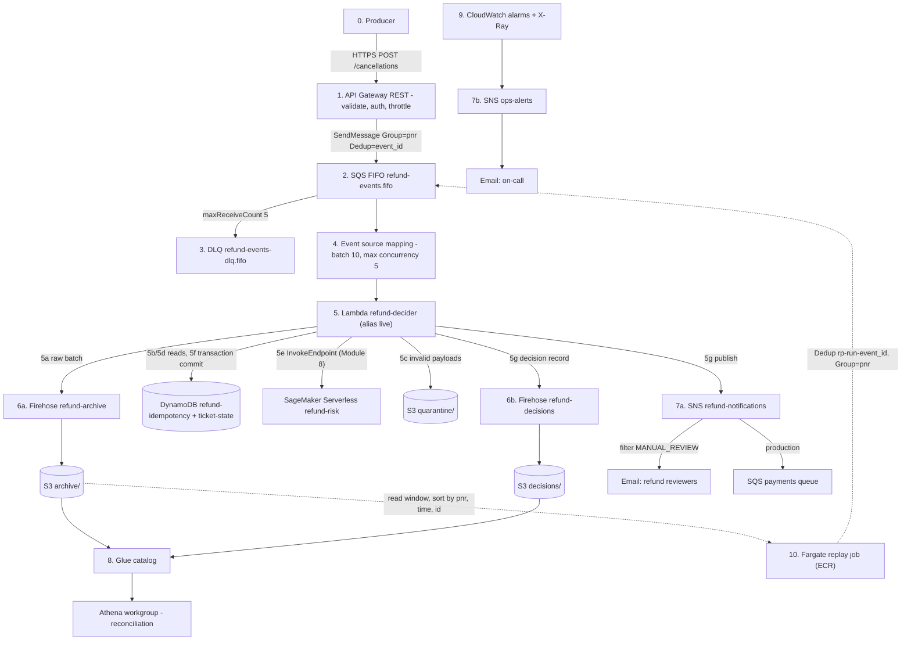

# Reference architecture: cancellation and refund pipeline

- **Agreed in class:** Day 2 (Module 2), 25 Nov 2026.
- **Used by:** Modules 6–10. Every later lab adds to this design; none replaces it.
- **Follows:** `AGENTS.md`, `docs/LOGGING_CONTRACT.md`, `docs/service-boundary-6q.md`. Where this file and `AGENTS.md` disagree, `AGENTS.md` wins. Raise a PR to fix this file.
- **Diagram:** `docs/reference-architecture.png`.

---

## 1. What it must do

| Requirement | Value |
|---|---|
| Volume | 2,000 cancellation events/day (~60k/month), peak 50/min |
| Ordering | strict per PNR |
| Money safety | never refund twice; never refund more than the booking record says; every event ends in exactly **one** recorded decision |
| Determinism | same event + same rule/model versions → same decision, on every retry, redrive and replay |
| Audit | every accepted event archived; every rejected request visible in access logs |
| Ops | failures alarmed to a human |
| Non-goals | no Step Functions; no Kinesis Data Streams or MSK |

---

## 2. Diagram

---

## 3. Event contract

The pipeline uses the same shape as the Day 2 lab (`day2/data/cancellation_events.json`). One JSON Schema file, `schemas/cancellation-event.v1.json` (Module 6), is used by **both** API Gateway and the Lambda.

| Field | Rule |
|---|---|
| `event_id` | `^[A-Za-z0-9-]{1,40}$`, unique per event. The idempotency key. |
| `event_type` | `cancellation` or `refund_correction` (a reviewer's outcome for a MANUAL_REVIEW). |
| `pnr` | `^[A-Z0-9]{6}$`. The ordering key. |
| `ticket_number` | `^\d{3}-\d{10}$`. **The refund unit:** one PNR can hold several tickets. |
| `airline_code`, `fare_class`, `od_pair`, `journey_date`, `departure_status`, `no_show_flag` | As in Day 2. |
| `fare_amount` | **JSON string** `^\d{1,9}\.\d{2}$` (for example `"8450.00"`). Never a JSON number. |
| `currency` | ISO-4217, from an allowlist in reference data. |
| `cancellation_timestamp` | UTC ISO-8601. Business time, used for ordering and stale checks. |
| `passenger_name`, `contact_email` | May be present. Never logged, never in notifications, never in decision records. Production producers should drop them (data minimisation). |

`correlation_id` travels in the `X-Correlation-Id` header, then as an SQS message attribute, then on every log line and decision record.

---

## 4. Money rules (`AGENTS.md`: Decimal, ROUND_HALF_UP, never float)

1. `fare_amount` must be a **string** with exactly 2 decimals. A JSON number (`8450.00` parses as a float), a bool or `"8450.0"` is rejected (`REJECT`, `R-INVALID`).
2. All maths runs in `Decimal`: `refund_amount = (fare * refund_pct / 100).quantize(0.01, ROUND_HALF_UP)`, which matches the Day 2 handler. `refund_pct` is an integer from `refund_rules.json`.
3. **The event's fare is a claim; the booking record is the truth.** The fare is checked against a pinned booking reference (`ref/bookings.json`, Module 7; a PSS lookup in production):
   - a mismatch gives `MANUAL_REVIEW`, `R-FAREMISMATCH`;
   - a ticket that is already refunded gives `REJECT`, `R-DUPREFUND`.
4. Amounts leave the Lambda as strings (`"617.28"`). DynamoDB returns `Decimal`: serialise it with `str(d.quantize(...))`, never `float()`. Athena columns are `DECIMAL(12,2)`, never `DOUBLE`.
5. `fare_amount` and `refund_amount` are **never logged** (logging contract). They live only in the archive, the decision records and DynamoDB.

---

## 5. Ticket state machine

DynamoDB `ticket-state` is keyed by `ticket_number` and holds `{state, version, last_event_ts, last_event_id, refunded_amount}`. A write succeeds only if `version` is unchanged since the read (optimistic locking).

Decisions use the logging-contract enum `APPROVE | REJECT | MANUAL_REVIEW`, plus a `refund_rule_id`.

| Current state | Event | Condition | New state | decision, refund_rule_id |
|---|---|---|---|---|
| any | any | `cancellation_timestamp` older than `last_event_ts` (ties broken by `event_id`) | unchanged | REJECT, `R-STALE` |
| NONE | cancellation | invalid payload | NONE | REJECT, `R-INVALID` |
| NONE | cancellation | fare ≠ booking record | REVIEW | MANUAL_REVIEW, `R-FAREMISMATCH` |
| NONE | cancellation | Day 2 rules → APPROVE, risk score ok | REFUNDED | APPROVE, `R-FLEX` / `R-BUSINESS` / … |
| NONE | cancellation | Day 2 rules → APPROVE, risk score high | REVIEW | MANUAL_REVIEW, `R-RISK` |
| NONE | cancellation | model unavailable | REVIEW | MANUAL_REVIEW, `R-NOMODEL` |
| NONE | cancellation | Day 2 rules → REJECT | CLOSED | REJECT, `R-NOSHOW` / `R-DEPARTED` / … |
| REVIEW | cancellation | – | REVIEW | MANUAL_REVIEW, `R-DUPPENDING` |
| REFUNDED | cancellation | – | REFUNDED | REJECT, `R-DUPREFUND` |
| CLOSED | cancellation | – | CLOSED | REJECT, `R-DECIDED` |
| REVIEW | refund_correction | reviewer outcome | REFUNDED / CLOSED | APPROVE / REJECT, `R-REVIEWED` |

Every row writes a decision record, so no event disappears silently. Same event_id with a different payload is caught before the state machine (step 5b): MANUAL_REVIEW, `R-CONFLICT`.

---

## 6. Hop by hop

### Hop 0: Producer
- POSTs the §3 contract.
- Retries on 5xx or timeout with the **same** `event_id`. That is safe end to end.

### Hop 1: API Gateway (REST API, direct SQS integration, no Lambda)
- **Request validation:** the request validator checks the body against the §3 schema. Malformed requests get a 400 and never reach SQS.
- **Auth:**
  - Labs: API key plus usage plan (rate 50 rps, burst 100). An API key identifies a caller; it does **not** authenticate.
  - Production: IAM SigV4. SigV4 also signs a hash of the body, so an amount altered in transit fails. Add AWS WAF (rate and body-size rules) and TLS 1.2 minimum.
- **Integration:** SQS `SendMessage` through a role allowed only `sqs:SendMessage` on this queue. The mapping template sets `MessageGroupId = pnr`, `MessageDeduplicationId = event_id`, and attribute `correlation_id` (from the header, else `$context.requestId`).
- **Responses:** SQS success returns **202** with the MessageId. SQS 4xx or 5xx returns **500**, so the producer retries. Never a silent 200.
- **Logging:** access logs without request bodies; execution logs at ERROR only, data trace off. 400s are visible in access logs and alarmed on 4XX rate. They are not in the archive.

### Hop 2: SQS FIFO `refund-events.fifo`
- `MessageGroupId = pnr` gives the ordering. `MessageDeduplicationId = event_id` gives the 5-minute dedup window.
- SSE-SQS encryption. Visibility timeout 180 s (6 × the Lambda timeout).
- **Queue policy:** deny `sqs:SendMessage` unless the principal is the API Gateway integration role or the replay task role. Nobody can inject an event that skips validation.

### Hop 3: DLQ `refund-events-dlq.fifo`
- FIFO, with `maxReceiveCount = 5`. `RedriveAllowPolicy = byQueue` (the main queue only).
- A failing message and the later messages of the **same PNR** move to the DLQ together and in order. A DLQ redrive returns them in order. Other PNRs are unaffected (see hop 5).
- Alarms on DLQ depth > 0 and DLQ age.

### Hop 4: Event source mapping
- Batch size 10, `ReportBatchItemFailures`, `MaximumConcurrency = 5`, Lambda reserved concurrency 5.

### Hop 5: Lambda `refund-decider` (Python 3.12, Powertools, alias `live`)
- Batch handling uses `SqsFifoPartialProcessor(skip_group_on_error=True)`. When a record fails, that record and the later records **of the same PNR** go back to the queue; other PNRs in the batch carry on. The default (`False`) would fail every remaining record in the batch.
- Each record then goes through these steps:

| Step | What it does |
|---|---|
| 5a Archive | One `firehose:PutRecordBatch` with all raw records of the batch, before any logic. Retry failed entries; if the retry fails, raise. |
| 5b Idempotency | `GetItem(event_id, ConsistentRead)`. A COMPLETED item with the same `payload_sha256` (sha256 of canonical JSON: sorted keys, no whitespace) is skipped, or re-emitted if `emitted=false`. A **different** hash gives MANUAL_REVIEW `R-CONFLICT` plus an alert. |
| 5c Validate | Schema plus §4 money checks plus reference checks. Invalid payloads are written to `quarantine/<reason>/<event_id>.json` (deterministic key) and get decision REJECT `R-INVALID`. |
| 5d Load state | `GetItem(ticket_number, ConsistentRead)` from `ticket-state`. |
| 5e Decide | Apply §5 using `cancellation_timestamp` (never `now()`). Day 2 refund rules, then SageMaker Serverless risk score (Module 8, 5 s timeout, MANUAL_REVIEW `R-NOMODEL` on failure). The decision stores its **pins**: `rules_sha256`, `ref_data_sha256`, `model_version`, `code_version` (Lambda version), `schema_version`. |
| 5f Commit | One `TransactWriteItems`: Put `refund-idempotency` (condition `attribute_not_exists(event_id)`) and Update `ticket-state` (condition `version = :read_version`). If the condition fails, go back to 5b. |
| 5g Emit | Decision record to Firehose `refund-decisions`, then publish to SNS `refund-notifications`. `decision_id = event_id`, so duplicates are identical. |
| 5h Mark emitted | Set `emitted=true`. A crash before this point re-emits the **stored** decision; the Lambda never recomputes. |

- **Logging** follows `docs/LOGGING_CONTRACT.md`:
  - `service = accelya-m7-<learner>-refund-decider`, `boundary = sqs(refund_events)->lambda(refund_decider)`.
  - Messages such as `refund.decided`, `refund.duplicate_skipped`, `refund.conflict`.
  - Keys allowed: `event_id`, `event_type`, `message_id`, `pnr`, `ticket_number`, `decision`, `refund_rule_id`, `attempt`, `duration_ms`, `error_type`. No amounts, no names.
- **Settings:** X-Ray active tracing. Timeout 30 s, memory 512 MB. DynamoDB on-demand with PITR on; TTL on idempotency items 90 days (the recovery replay horizon).

### Hop 6: Firehose to S3
- Two streams, `refund-archive` and `refund-decisions`. Buffer 60 s / 5 MB, JSON lines, GZIP.
- Prefixes: `archive/ingest_dt=!{timestamp:yyyy-MM-dd}/` and `decisions/ingest_dt=!{timestamp:yyyy-MM-dd}/`, plus an error-output prefix.
- `ingest_dt` is **arrival time in UTC**. Business reporting uses `business_date`, derived from `cancellation_timestamp` in the declared settlement timezone (parameter `SettlementTz`; default UTC until Accelya confirms).
- Firehose is at-least-once, so every query counts `DISTINCT event_id`.
- **Bucket:** Block Public Access, BucketOwnerEnforced, versioning on, deny non-TLS. Only the Firehose role may write `archive/` and `decisions/`. Nobody may delete object versions. Lifecycle: quarantine 30 days, Athena results 7 days.

### Hop 7: SNS
- **`refund-notifications`:**
  - Email for reviewers, with filter `{"decision": ["MANUAL_REVIEW"]}`. The body holds decision, `refund_rule_id`, `event_id`, `correlation_id` and a masked PNR only.
  - Production: an SQS subscription for payments. The payments queue policy allows **only** this topic (`aws:SourceArn`). Payments dedupes on `decision_id`.
- **`ops-alerts`:** fed by CloudWatch alarms. CloudWatch **cannot publish to a topic encrypted with the AWS-managed `aws/sns` key**: use a customer-managed KMS key that allows `cloudwatch.amazonaws.com`, or leave SSE off on this topic only in the sandbox (it carries no customer data).
- Confirm email subscriptions from your inbox before they deliver.

### Hop 8: Glue and Athena
- Tables `archive`, `decisions`, `quarantine_index` with partition projection on `ingest_dt`.
- Workgroup with enforced result location, SSE, and a bytes-scanned limit.
- **Reconciliation (balances by construction):** `DISTINCT event_id in archive = DISTINCT event_id in decisions + event_ids in the DLQ`. Run it for a closed window (day D, after D+1 02:00 UTC).
- **Over-refund check:** approved `refund_amount` per `ticket_number` must never exceed the booking fare. The query returns zero rows on a healthy system.
- **Settlement:** `SUM(refund_amount)` (`DECIMAL(12,2)`) per `business_date` and `currency` where `decision='APPROVE'`.

### Hop 9: CloudWatch alarms → SNS `ops-alerts`

| Alarm | Condition |
|---|---|
| DLQ | visible > 0; oldest age > 1 h |
| Stuck PNR | main queue `ApproximateAgeOfOldestMessage` > 300 s |
| Lambda | `Errors` > 0; `Throttles` > 0 |
| API | `5XXError` > 0; 4XX rate > 5 % over 5 min |
| Firehose | `DeliveryToS3.DataFreshness` > 900 s |
| DynamoDB | `SystemErrors` > 0; `ThrottledRequests` > 0 |
| SageMaker | `Invocation5XXErrors` > 0; `ModelSetupTime` p90 > 4 s |
| Business | `R-CONFLICT` > 0; `MANUAL_REVIEW` > N per hour |

Log retention: 7 days in the labs, 30 in production.

### Hop 10: Fargate replay job (image in ECR, `ecs run-task`)
- **Recovery mode** (default, window at most 90 days):
  - read `archive/` and de-duplicate by `event_id`;
  - sort by `(pnr, cancellation_timestamp, event_id)`;
  - send sequentially per PNR to the FIFO queue with `MessageDeduplicationId = rp-<run_id>-<event_id>`.
  Completed events are skipped by 5b; un-emitted ones are re-emitted.
- **Correction mode:** never re-drive old events through the money path. Athena findings become **new** `refund_correction` events.
- **Network:**
  - Labs: default VPC public subnet with a public IP.
  - Production: private subnets with VPC endpoints (S3, SQS, ECR, CloudWatch Logs).
- **IAM:** the execution role (ECR pull, logs) is separate from the task role (`s3:GetObject` on `archive/*`, `sqs:SendMessage` on the main queue).

---

## 7. Six service-boundary answers (key hops)

| Hop | Push/pull | Sync/async | Payload | Role (minimum) | Failure path | Correlation ID |
|---|---|---|---|---|---|---|
| Producer → API Gateway | push | sync (202) | §3 schema v1 | API key (labs) / SigV4 caller | 400 to producer; 500 → producer retries same event_id | `X-Correlation-Id` header, else requestId |
| API Gateway → SQS | push | sync | message body = event; attrs | integration role: `sqs:SendMessage` on one queue | 500 to producer | SQS message attribute |
| SQS → Lambda | pull (ESM) | async | SQS batch | function role: receive/delete on one queue | partial batch → retry ×5 → DLQ | read from the attribute, on every log line |
| Lambda → DynamoDB | push | sync | idempotency + ticket-state items | `GetItem`, `TransactWriteItems` on two tables | condition fail → re-read; error → record retried | stored on the item |
| Lambda → Firehose / SNS | push | sync call, async delivery | decision record | `PutRecordBatch` on 2 streams; `Publish` on 1 topic | error → record retried; re-emit stored decision | field in record, message attribute |
| Lambda → SageMaker | push | sync, 5 s | features → score | `InvokeEndpoint` on 1 endpoint | MANUAL_REVIEW `R-NOMODEL` | logged with event_id |

---

## 8. Names (`AGENTS.md`: `accelya-m<module>-<learner>-`)

| Module | Resources |
|---|---|
| 6 | API `accelya-m6-<learner>-refund-api`; queues `accelya-m6-<learner>-refund-events.fifo` and `…-refund-events-dlq.fifo`; Firehose `accelya-m6-<learner>-refund-archive`; bucket `accelya-m6-<learner>-refund-data-<account-id>` (the SAM template supplies the account id) |
| 7 | Lambda `accelya-m7-<learner>-refund-decider`; tables `accelya-m7-<learner>-refund-idempotency` and `…-ticket-state`; Firehose `accelya-m7-<learner>-refund-decisions`; topics `accelya-m7-<learner>-refund-notifications` and `…-ops-alerts` |
| 8 | SageMaker endpoint `accelya-m8-<learner>-refund-risk` |
| 10 | Glue database `accelya_m10_<learner>` (Glue needs underscores); Athena workgroup `accelya-m10-<learner>`; ECR repo and ECS task `accelya-m10-<learner>-replay` |

The pipeline uses **one** Lambda function, which counts towards the sandbox limit of 10 for the whole course.

---

## 9. Determinism test (Module 10)
`tests/golden/`: a fixed event file covering every §5 row, plus the expected decisions. Run the decider twice, then once after a simulated replay. Assert:
1. the decisions are identical to the expected file;
2. the sha256 of the sorted decisions is identical across all three runs;
3. no event has more than one terminal decision.

---

## 10. Why not the alternatives

| Alternative | Why not |
|---|---|
| Aurora Serverless v2 | Ordering comes from FIFO, not a database. Aurora brings a cost floor or a cold resume, a VPC and connections. Nothing here needs SQL joins. |
| EventBridge Pipes polling Aurora | Not possible: Pipes sources are SQS, Kinesis, DynamoDB Streams, MSK/Kafka and MQ. Check every arrow against the documentation. |
| SQS Standard / EventBridge bus | No per-PNR ordering. |
| Step Functions | Non-goal: the flow is a single decision step. |
| Kinesis Data Streams | Ordering per shard, not per PNR; you pay per shard-hour; out of scope. |
| An ingest Lambda behind API Gateway | An extra hop with no value; the direct integration does the job. |
| One S3 PutObject per event | Many tiny files and slow Athena. Firehose batches, compresses and partitions. |
| Recomputing a decision on retry | Not deterministic: a model timeout could flip the outcome. Store once, replay the stored decision. |

---

## 11. Module map

| Module | What you build |
|---|---|
| 6 | Hops 1–3, event schema, correlation ID, archive (6a) |
| 7 | Hop 5 (steps 5b–5h), ticket state machine, decisions (6b), SNS, alarms |
| 8 | Step 5e: SageMaker Serverless risk score with a pinned `model_version` |
| 10 | Athena reconciliation and over-refund check, replay and correction job, golden determinism test |

**Approximate cost** at 60k events/month, excluding SageMaker: about **$1–2/month**. These are list-price estimates.
